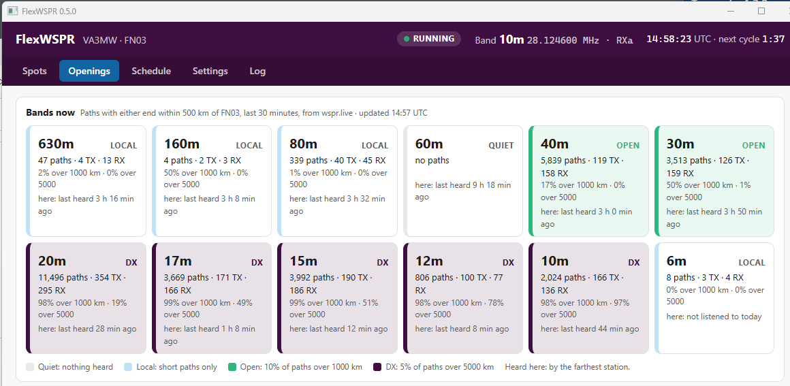
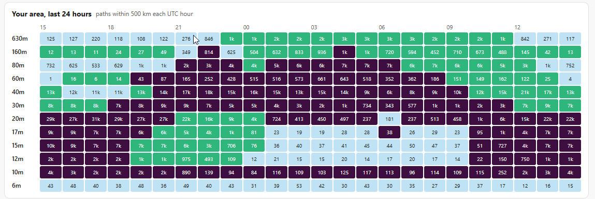
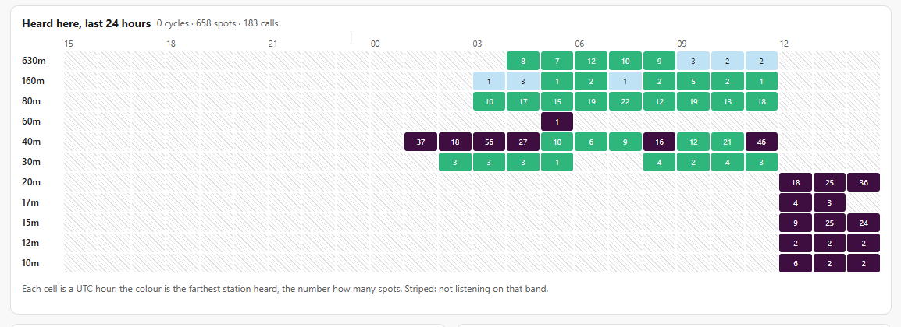

# FlexWSPR

**Web page: <https://va3mw.github.io/FlexWSPR/>** · [Download](https://github.com/va3mw/FlexWSPR/releases/latest)

A WSPR receiver for FlexRadio, for Windows, Debian and Raspberry Pi. It
connects to the radio, opens a DAX IQ stream, records each two-minute cycle
and decodes it with `wsprd` (from WSJT-X). It can rotate through bands, pick a
receive antenna per band, rank the best signal heard and upload spots to
wsprnet.org. The Openings tab shows which bands are open from your area,
from your own receiver and from the public WSPR database.

**FlexWSPR is receive only.** It never keys the radio, and there are no plans
to add a transmit feature. To transmit WSPR, use WSJT-X.

It comes two ways, sharing one engine and one GUI:

| Program | GUI | For |
|---|---|---|
| `flexwspr` | A web page it serves itself (`http://<host>:8080`) | A headless Pi or Debian box; also runs on Windows |
| `flexwspr-gui` | The same page in its own window (Wails), and also as a web page | Windows and Linux desktops |

## The GUI

**Spots**
- State, radio, the band and antenna now, the next few bands, spots per band
  and the wsprnet upload count.
- **Best signal:** the highest-scoring spot since start, and the best on each
  band (see [Best signal](#best-signal)).
- The last cycles and a spot table with distance, filterable by band.

**Openings**: a screen to leave up on the desktop. It refreshes every minute.
- **Bands now:** one tile per band, 160 m to 6 m, rated from the last 30
  minutes of spots at [wspr.live](https://wspr.live) whose transmitter or
  receiver is within 500 km of your grid (set in Settings). So it covers
  bands FlexWSPR is not on. Each tile also says when you last heard something
  on that band.

  | Rating | Means |
  |---|---|
  | Quiet | No paths |
  | Local | Paths, but few over 1000 km |
  | Open | At least 3 paths over 1000 km, and 10% or more of all paths |
  | DX | At least 3 paths over 5000 km, and 5% or more of all paths |

  Busy bands always carry a few long paths from big stations, hence the
  percentages. Hover over a tile for the longest path.

  
- **Your area, last 24 hours:** the same rating for each band and UTC hour,
  from wspr.live, so you can see when each band usually opens.

  
- **Heard here, last 24 hours:** your own spots per band and hour, coloured
  by the farthest station heard. Striped cells are hours FlexWSPR was not on
  that band; grey ones it listened and heard nothing.

  
- **By band** and **Stations heard** tables for the last 24 hours.

The 24-hour history is reloaded from `spots.txt` and `cycles.txt` (one line
per decoded cycle, new in 0.5.0) in the data folder when FlexWSPR starts.
wspr.live is asked at most every 5 minutes for the last 30 minutes and every
15 minutes for the day, however many pages are open; turn it off in
**Settings → Openings**.

**Schedule**: pick one of three modes, then **Save and apply**.

| Mode | What it does |
|---|---|
| One band | Stays on the default band. |
| Band rotation | Steps through a band list all day, so many cycles on each. Pick a range (e.g. 80 m to 6 m) and click *Use this range*, then click chips to drop or add bands. The tab shows the time on each band and how often each comes round: 10 bands × 3 cycles is 6 min on each band, every band once an hour. |
| Time slots | Each UTC time range gets its own band list and cycle count; outside every slot it stays on the default band. The first matching slot wins. |

A preview shows the next hour of cycles with the changes before you save.
Rotations are counted in two-minute cycles since 1970, so they carry on
smoothly over midnight and restarts. A 10-band rotation of one cycle each
starts on its first band at :00, :20 and :40 every hour; with 160 m to 10 m
in order this should match WSJT-X's coordinated band hopping (not yet checked
against WSJT-X).

**Settings**
- Callsign, grid, upload to wsprnet.
- Radio IP (or *Find radios*), DIGU slice on or off.
- **Receive antenna:** a default, and one for each band. The menus list the
  antennas the radio reports once FlexWSPR is connected (ANT1, ANT2, RXa,
  RXb, XVTa, XVTb on a FLEX-6600).
- DAX IQ channel and rate; decoder options.
- Saving rewrites the config file and restarts the receiver.

**Log**: the program's log.

**Help**: getting started, what each tab does, troubleshooting, credits and
the license.

## Best signal

Each spot gets a score: the SNR it would have had from a 1 W transmitter
1000 km away.

```
score = SNR − (power dBm − 30) + 20·log10(km ÷ 1000)
```

- **Power:** a 5 W station (37 dBm) loses 7 dB, a 200 mW station (23 dBm)
  gains 7 dB.
- **Distance:** each doubling adds 6 dB, as received power falls roughly with
  the square of distance. Under 100 km counts as 100 km.
- Spots with an unknown grid or a hashed `<…>` call are not scored.

So a weak, distant signal can win: −24 dB from 200 mW at 7000 km scores −0.1,
while −10 dB from 5 W at 800 km scores −18.9. At the same distance and power,
the stronger signal still ranks higher.

## How it works

1. Finds the radio by discovery (or its IP), connects to the SmartSDR API on
   TCP 4992 **as a GUI client**: only GUI clients can own a panadapter.
2. Creates a panadapter centred on dial + 1500 Hz (the middle of the WSPR
   window) on the band's antenna, points it at DAX IQ channel 1 and opens a
   24 kHz DAX IQ stream. Optionally adds a DIGU slice on the dial frequency.
3. Shifts and decimates the IQ to 375 samples/s complex, in pure Go.
4. Records 114 s from each even UTC minute, using the system clock, and writes
   a `YYMMDD_HHMM.c2` file.
5. Runs `wsprd` on it and adds the spots to the GUI, `spots.txt` and the log.
6. **Band changes:** in the 6 s after a capture ends, while that cycle decodes,
   removes the panadapter, slice and stream and builds new ones on the next
   band. (Retuning the existing panadapter left the stream carrying only noise
   on the new band on a FLEX-6600.)
7. With upload on, sends the spots to wsprnet.org the way WSJT-X does (one form
   POST per spot, or a `wsprstat` report for an empty cycle). While wsprnet is
   unreachable the queue is kept in `upload_queue.json` and retried; spots
   older than 24 h are dropped.

## Build

With Go 1.26:

```bash
./build.sh 0.5.1
```

or on Windows:

```powershell
.\build.ps1 -Version 0.5.1
```

| File in `dist/` | For |
|---|---|
| `flexwspr-linux-amd64` | Debian on x86-64, headless |
| `flexwspr-linux-arm64` | Raspberry Pi OS 64-bit, headless |
| `flexwspr-linux-arm` | Raspberry Pi OS 32-bit, headless |
| `flexwspr-windows-amd64.exe` | Windows, headless (web page) |
| `flexwspr-gui-windows-amd64.exe` | Windows desktop app (needs the WebView2 runtime, built into Windows 10/11) |
| `flexwspr-gui-linux-<arch>` | Linux desktop app, only when built on Linux (below) |

The Linux desktop app uses GTK and WebKit, so build it on the Linux machine:

```bash
sudo apt install golang build-essential pkg-config libgtk-3-dev libwebkit2gtk-4.1-dev
./build.sh 0.5.1
```

## Run on Windows

1. Install WSJT-X: FlexWSPR finds `wsprd.exe` in `C:\WSJT\wsjtx\bin`,
   `%ProgramFiles%\wsjtx\bin` or on PATH.
2. Run `flexwspr-gui-windows-amd64.exe`. On first start it opens on Settings:
   enter your callsign and grid, pick the radio and antennas, and save.
3. Settings are saved to `C:\ProgramData\FlexWSPR\flexwspr.yaml` (or
   `flexwspr.yaml` next to the program, if one is there). Data and the log
   (`flexwspr.log`) go to `C:\ProgramData\FlexWSPR\data`.

While the app runs it also serves the GUI as a web page, at
`http://localhost:8080` on this PC. In the app's **Settings → Decoder and
files**, set **Web page port**, and tick **Reachable from other computers**
to watch it from a phone or another PC (Windows asks once to allow it through
the firewall); a blank port turns the page off. The page moves as soon as you
save. In the config file this is `web.listen`: `"127.0.0.1:8080"` (this PC
only), `":8080"` (other computers) or `"off"`. Over the network the page
cannot change the program paths or its own port, and it has no password, so
keep it on your own LAN.

Closing the window removes FlexWSPR's panadapter, slice and stream from the
radio. Only one copy can run at a time. Windows syncs its clock less tightly
than chrony; check it with `w32tm /query /status`.

## Run on Debian / Raspberry Pi (headless)

```bash
sudo apt install wsjtx chrony
sudo install flexwspr-linux-arm64 /usr/local/bin/flexwspr
sudo cp flexwspr.service /etc/systemd/system/
sudo systemctl enable --now flexwspr
```

Then browse to `http://<pi-name>:8080` from any computer and set it up there.
Under systemd the config is `/var/lib/flexwspr/flexwspr.yaml` (created on
the first save), next to the data. `journalctl -u flexwspr -f` shows the log.

Over the network the page can change station, radio, antenna, schedule and
upload settings, but not the program paths (wsprd, data folder, web address);
those are set in the config file. The page has no password: keep port 8080 on
your own LAN, or set `web.listen: "127.0.0.1:8080"`.

## Config file

Everything in the GUI is in the YAML file; see `flexwspr.example.yaml`. The
schedule and antenna parts look like this:

```yaml
band: 40m             # the default band
rxant: RX_A           # the default antenna
antennas:             # per band; others use rxant
  160m: RX_B
  20m: ANT1
schedule:
  mode: rotation      # off, rotation or slots
  rotation:
    bands: [80m, 60m, 40m, 30m, 20m, 17m, 15m, 12m, 10m, 6m]
    cycles: 3
```

Files from 0.3 with `schedule: enabled: true` still load, as time slots.

## Things to know

- **Clock:** WSPR needs the clock within about ±1 s.
- **GUI client:** FlexWSPR takes one of the radio's GUI client connections. On
  a FLEX-6300 that probably means SmartSDR cannot connect while it runs.
- **DAX IQ channel:** don't run two copies of FlexWSPR (or another DAX IQ
  program) on the same channel.
- **Tested** on a FLEX-6600 (v4.3.16) with RX_A on single bands (20 m, 30 m,
  40 m, 80 m). Band changes by rebuilding the panadapter (0.4.0) have not yet
  been verified on air. Not yet tried on a 6300 (v3 firmware), and the Linux
  builds have not yet run on Linux.
- If nothing ever decodes, the spectrum may be mirrored: try *Flip Q in .c2
  files*, then *Swap I and Q*. With `keep_c2: true`, test saved files offline:
  `flexwspr -config ... -decode /var/lib/flexwspr/261103_1406.c2`.

## Layout

| Path | What |
|---|---|
| `main.go` | Headless program: web page, `-decode` tool |
| `cmd/flexwspr-gui` | Desktop app (Wails window around the same GUI) |
| `cmd/discover` | Lists radios on the LAN |
| `internal/web` | GUI page (`static/`) and JSON API |
| `internal/app` | Station: radio setup, IQ loop, band changes, decoding, status, signal score |
| `internal/config` | YAML config, bands, schedule, antennas, per-OS defaults |
| `internal/flex` | Discovery, TCP API client, VITA-49 / DAX IQ parsing |
| `internal/dsp` | NCO and decimation to 375 Hz |
| `internal/wspr` | Cycle capture, `.c2` writer, `wsprd` runner and parser |
| `internal/area` | wspr.live queries for the Openings tab |
| `internal/upload` | wsprnet.org uploader with a saved retry queue |
| `build.sh`, `build.ps1` | Builds into `dist/` |

## Credits

- WSPR and the `wsprd` decoder: Joe Taylor, K1JT, Steve Franke, K9AN, and the
  WSJT development group, in [WSJT-X](https://wsjt.sourceforge.io/) (GPL v3).
  FlexWSPR runs the installed `wsprd` as a separate program and does not
  include it.
- [wsprnet.org](https://www.wsprnet.org/) for the spot database FlexWSPR uploads to,
  and [wspr.live](https://wspr.live/) for the public database behind the
  Openings tab.
- FlexRadio for the SmartSDR API and DAX IQ. FlexRadio, SmartSDR and DAX are
  trademarks of FlexRadio Systems; FlexWSPR is not a FlexRadio product.
- [Wails](https://wails.io/) (MIT) and [go-yaml](https://github.com/go-yaml/yaml)
  (MIT and Apache 2.0).

## License

MIT; see [LICENSE](LICENSE).
